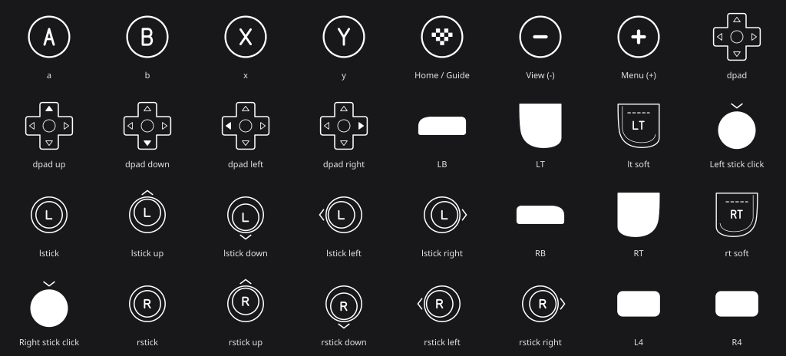

# 8BitDo Ultimate 2C

This preset matches the Xbox-layout Ultimate 2C with a consistent white SVG set:
ABXY, Home/Guide, minus/View, plus/Menu, bumpers, triggers, D-pad, sticks and L4/R4.
It includes 32 glyphs and 94 Steam resource aliases, including query-string URLs.

Choose **8BitDo Ultimate 2C (glyphs only)** in the existing **Handheld** selector.
The preset uses the project's shared face-button/inline Guide rules and adds
device-specific glyph URLs. It deliberately does not load `controller-image.css`
or any feature-hiding modules: Steam keeps its own controller diagrams, animation,
button-test feedback and clickable areas.

## Scope and validation

- This is a manually selected appearance preset, applied to the Steam client UI.
- It changes neither mappings nor hardware identity and does not modify in-game assets.
- L4/R4 glyphs appear only where Steam already has a corresponding prompt; this does
  not make additional inputs available over an unsupported connection.
- The physical star (Turbo) and square (Mapping) are not assigned to unrelated
  capture/C prompts. The shared trackpad/other device features remain untouched.
- The artwork was used with a local Windows/Millennium Steam theme. This contribution
  ports the glyphs to CSS Loader's existing preset structure; physical Decky/SteamOS
  validation is still pending. Steam-version-specific embedded tutorial images from
  the local theme are not part of this portable preset.

Contributed by [MaomaoADHD](https://github.com/MaomaoADHD), under the repository's
[MIT license](../../LICENSE). The project is an independent community theme.
